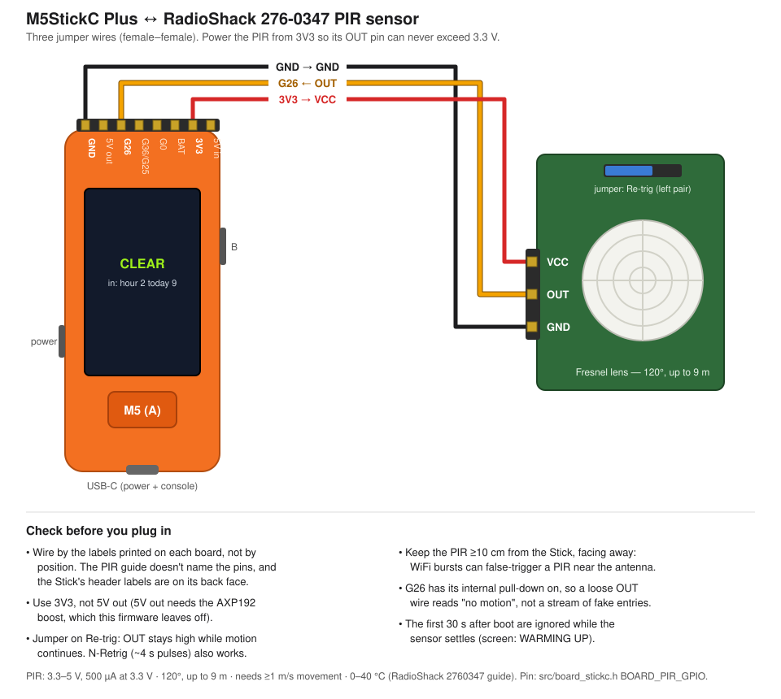

# M5StickCPlus_Hive_Sentinel_IR

A people-presence sentinel: an M5StickC Plus with a RadioShack 276-0347 PIR
sensor watches a room, counts each time someone enters, and publishes
presence over MQTT. Any subscriber, on any network, can follow it. The Stick's
screen shows counts and occupied time for the current hour, day, week and
month.

Forked from [M5StickCPlus_Hive_Ear](../M5StickCPlus_Hive_Ear), keeping its
board layer, button legends and power key. The WiFi, MQTT and console
plumbing follows [Voice_XR](../M5StickCPlus-Blinky_Voice_XR). The Sentinel
uses WiFi only; Bluetooth is compiled out.

**Status (2026-10-28):** fw 0.3.1 adds WiFi setup from a phone (below):
WIFI LOGIN used to do nothing at all when the Stick had no WiFi. fw 0.3.0 added sign-in-page WiFi support (below), the
TLS MQTT fallback, and the counters in `activity`. fw 0.2.1 added the
check-sensor warning. fw 0.2.0 added the `activity` and `history` topics,
an ACTIVE state on screen, the clear countdown, and screen wake on state
changes. All are checked on hardware with `pir-sim`. Earlier: fw 0.1.0, flashed and running on a StickC Plus
(`MagNET-Sentinel-3cf4`) with the PIR wired. Confirmed on hardware: PIR input on
G26 (entry counted), WiFi, MQTT through `broker.hivemq.com`, the retained state
and the offline last will, SNTP (the state is re-sent with a timestamp once the
clock is set), and the 30 s warm-up. Still to confirm with a walk test: the
`present` and `clear` pings, and the screens and menu.

Console tip: `pio device monitor` needs `-b 115200 --dtr 0 --rts 0` when run
outside this folder. Asserted DTR/RTS hold this board in reset, and the default
of 9600 baud shows garbage. `tools/sentinel_wifi.py` sets WiFi without a
monitor.

## Wiring



| PIR pin | StickC Plus top header |
|---------|------------------------|
| VCC     | **3V3** |
| OUT     | **G26** |
| GND     | **GND** |

- **Use 3V3, not 5V.** At 3.3 V supply the PIR's OUT can never exceed 3.3 V.
  The header's 5V-out pin needs the AXP192 boost, which this firmware leaves
  off.
- **Wire by the printed labels, not by position.** The RadioShack guide never
  says which header pin is which. The Stick's header labels are printed on its
  back face.
- **Put the trigger jumper on Re-trig.** OUT then stays high for as long as
  motion continues. N-Retrig gives ~4 s pulses, which also work but are
  noisier.
- **Keep the PIR at least 10 cm from the Stick, facing away.** A PIR right
  next to an ESP32 antenna can false-trigger on WiFi bursts.

## Setup

```bash
pio run -t upload            # StickC Plus = FTDI port, e.g. /dev/cu.usbserial-XXXXXXXX
pio device monitor           # 115200, Forth console
```

At the console:

```
wifi-ssid          ( prompts )
wifi-pass          ( prompts; Enter = open network )
wifi-connect       ( saves to NVS, reconnects on every boot )
tz                 ( POSIX TZ; default PST8PDT,M3.2.0,M11.1.0. Sets where hour/day/week/month roll over )
sen-stat           ( everything at a glance )
```

No laptop? **Menu → WIFI SETUP** (or WIFI LOGIN while the WiFi is down) does
the same from a phone:

1. The Sentinel stops retrying its saved network, looks for networks, and
   opens its own: `Sentinel-<id>-setup`, with a fresh 8-digit password on
   screen.
2. Join it from a phone. The phone's "sign in to network" sheet opens the
   setup page (it is also at `http://10.77.0.1`). The Sentinel answers every
   DNS name with its own address, which is what makes the sheet appear.
3. Pick the network, type its password (empty = open network), and tap
   **Join**. The Sentinel saves it, closes the setup network and joins.

**B** cancels, and the setup network closes by itself after 10 minutes. Both
go back to the saved network. When a whole round of retries fails, the home
screen says `WiFi failing: menu>WIFI SETUP`.

The broker defaults to the one the other MagNET nodes use,
`mqtt://broker.hivemq.com:1883`; change it with `mqtt-broker`.

## WiFi with a sign-in page (captive portals)

After every WiFi join, the Sentinel fetches Google's connectivity check
page. On an open network it gets back an empty "204" reply; anything else
means a sign-in page is in the way.

1. **Automatic.** The Sentinel loads the sign-in page and picks the form that
   looks like "I agree / Connect". It ticks the checkboxes, keeps the session
   cookie, presses the button, and checks again. This works for plain-HTML
   click-through pages. It deliberately won't fill in an empty email,
   room-number or password box. The parser is `src/portal.c`.
2. **Phone login, for every other portal.** The screen shows
   **LOGIN NEEDED**.
   1. Press **B**. The Sentinel opens its own WiFi network,
      `Sentinel-<id>-login`, with a fresh 8-digit password on screen.
   2. Join it from a phone. The Sentinel forwards the phone's traffic onto
      the venue network (NAPT), so the venue only sees the Sentinel.
   3. Complete the sign-in page that opens on the phone. The venue then lets
      the **Sentinel** in.
   4. The login network closes once the check page answers 204, or after
      10 minutes. **WIFI LOGIN** in the menu and `net-login` on the console
      open it at any time. With no WiFi there is nothing to forward, so
      they open the WiFi setup network instead (see Setup).
3. **Expired sessions.** If MQTT stays down for 2 minutes while the internet
   looked open, the Sentinel checks again. This is how an expired portal
   session shows up.
4. **Blocked MQTT port.** Some guest networks block 1883 even after sign-in.
   After 60 s of "internet open, MQTT down", the Sentinel switches to
   `wss://broker.hivemq.com:8884/mqtt` (TLS WebSocket, certificate checked).
   The two then alternate. `mqtt-alt` changes the alternate; `-` disables it.

**Tested on hardware (2026-10-26)**, against `tools/fake_portal.py` running
on a Mac:
- **Automatic accept:** the Stick handled a redirect, a session cookie, two
  forms (it picked the right one), an HTML-entity token, the terms checkbox
  and the named Connect button, and was online in under 2 s.
- **Email portal:** the Stick refused to fill in the email, reported
  "sign-in page needs a person", and showed LOGIN NEEDED.
- **Phone login:** an Android 14 phone joined `Sentinel-3cf4-login`, got
  10.77.0.2, and reached the LAN through the Stick. The phone completed the
  portal form, and the portal saw the request come from the **Stick's**
  address. The login network then closed itself.
- **TLS fallback:** MQTT over `wss://…:8884` connected and published.

Not yet tried at a real hotel or café.

> **Known quirk:** when a phone joins the login network, the Stick's own
> WiFi link drops once and reconnects about 8 s later. This happens on the
> ESP32 when it runs as client and access point at once. The login network
> stays up through a 60 s grace period, so the sign-in still works.

Bench test: run `python3 tools/fake_portal.py` (or `--mode email`) on a
computer on the same network, then on the console run `net-check-url` with
`http://<computer-ip>:8099/generate_204`, then `net-check`. `net-check-url`
then `-` restores the real check; a reboot does too.

## Using it

The legends on screen point at the buttons: **B** is the side button, shown
by the top bar with arrows up. **A** is the big front button, shown by the
bottom bar with an arrow right.

| Screen | Shows | A | B |
|--------|-------|---|---|
| Home | WARMING UP / ACTIVE (motion now) / PRESENT / CLEAR, time since the last change, entries this hour and today, network, clock, battery, then "clear in Nm if still" while present or seconds of motion in the last 5 min | stats | menu |
| Stats | entries and occupied h:mm for hour / day / week / month | home | menu |
| Menu | RESET HOUR / DAY / WEEK / MONTH / ALL, DEVICE INFO, EXIT | select | next item |
| Confirm | "RESET DAY?" | yes, reset | no |
| Device info | hostname, WiFi/IP, broker, topic, hold/repeat | home | menu |

- **Power key** (bottom edge): a short press goes home; hold 1.5 s to power
  off.
- **Dimming:** the screen dims after 60 s. The first press after that only
  wakes it. Any change of presence state (warmed up, enter, clear) lights it
  again and returns to the home page.
- **LED:** the red LED lights while the PIR reports motion, which helps with a
  walk test.

## Presence model

```
WARMUP ─(30 s)─▶ CLEAR ─(motion)─▶ PRESENT ─(no motion for hold, 5 min)─▶ CLEAR
                                     └─ every repeat (5 min) while motion keeps coming: "present"
```

- **enter:** sent on CLEAR → PRESENT. Each one counts one room entry.
- **present:** sent every `repeat` (5 min) while there has been motion within
  the hold window.
- **clear:** sent once there has been no motion for `hold` (5 min). It carries
  the visit length.
- **Occupied time:** counted from entry up to the *last motion*, so the hold
  window after someone leaves is not included.
- **Tuning:** `N pir-hold` and `N pir-repeat` (seconds, saved to NVS). A
  longer hold means fewer false "clears" when someone sits still, since a PIR
  only sees movement. The cost is that the room is reported clear later.

## Stats

Each counter belongs to a calendar period in local time: the hour, the day,
the ISO week (starting Monday) and the month.
- **Rollover:** when a period ends, the counter is published as a `rollover`
  event and starts again from zero.
- **Manual reset:** the menu or `reset-hour` / `-day` / `-week` / `-month` /
  `-all` zero a counter early and publish a `reset` event.
- **Persistence:** counters are saved to NVS on every enter and clear, and
  every 10 min while someone is present, so they survive a reboot.
- **Before the clock syncs:** entries are still counted. The first SNTP sync
  attaches them to the current period.

## MQTT

Base topic: `iotj/magnet/sentinel/<mac4>`, where `<mac4>` is the last 4 hex
digits of the WiFi MAC. Change it with `mqtt-base`.

| Topic | QoS | Retained | Payload |
|-------|-----|----------|---------|
| `<base>/state` | 1 | yes | current state + stats; the last will is `{"state":"offline","online":false}` (keepalive 30 s → offline shows within ~45 s) |
| `<base>/event` | 1 | no | `enter` · `present` · `clear` · `rollover` · `reset` |
| `<base>/activity` | 0 | yes | motion right now, the clear countdown, and the last 5 min (fw 0.2.0) |
| `<base>/history` | 1 | yes | occupied seconds per 15 min over the last 24 h (fw 0.2.0) |

Every payload has the same fields:

```json
{"id":"a1b2","ev":"enter","state":"present","ts":1793052245,
 "local":"2026-10-26T16:04:05-0700","up_s":5120,"since_s":0,
 "stats":{"hour":{"entries":1,"occ_s":0},"day":{"entries":5,"occ_s":3720},
          "week":{"entries":9,"occ_s":9000},"month":{"entries":30,"occ_s":40000}}}
```

- **`ts` / `local`:** `ts` is `null` and `local` is `""` until SNTP has synced.
- **Extra fields by event:**
  - `present` / `clear`: `visit_s`.
  - `rollover`: `period`, `label` (`2026-10-26T15`, `2026-10-26`,
    `2026-W44`, `2026-10`), `entries` and `occ_s` for the period that closed.
  - `reset`: `periods`.
- **Offline buffering:** while MQTT is down, events queue on the device (10
  deep, oldest dropped first). Once reconnected, the retained state is
  refreshed first.

`activity` goes out the moment motion starts or stops, then every 10 s while
anything is in the 5-min window:

```json
{"id":"3cf4","active":false,"state":"present","ts":1793077607,"last_motion_s":10,
 "clear_in_s":20,"hold_s":30,"bin_s":10,"bins_pct":[0,…,0,55,25,0]}
```

- `bins_pct`: 30 bins of 10 s, oldest first, giving the percent of each bin
  with motion.
- `clear_in_s`: counts down from the *last* motion. Every sighting restarts
  it. It is `null` unless someone is present.

**Check sensor.** A PIR with a loose wire reads exactly like an empty room,
because the pull-down holds G26 low. Long silence is the only sign.
- **The limit:** once the sensor has seen no motion for `quiet_after_s`
  (12 h by default; `N pir-quiet` sets it in hours), `check_sensor` turns
  true in both `activity` and `state`.
- **What it does:** the Stick's screen lights up with CHECK SENSOR, and the
  app shows a warning on the card and on the Dashboard.
- **Clearing it:** the next motion clears it.
- **`quiet_s`:** seconds without motion when the message was sent. The app
  counts on from it, so its warning appears on time without a new message.

`history` goes out at each 15-min boundary, and at most once a minute while
the current bin fills:

```json
{"id":"3cf4","ts":1793077615,"bin_s":900,"end":1793077200,"bins_s":[0,…,0,7]}
```

- `bins_s`: 96 bins of occupied seconds, oldest first.
- `end`: the unix start of the newest bin, which is still filling. It is
  `null` until the clock is set.
- **Persistence:** the history is saved to NVS, so it survives a reboot. The
  5-min ring is kept in memory only.

Watch from anywhere: the MagNET app (**Dashboard → Presence sentinels**), or
from a terminal:

```bash
pip install -r tools/requirements.txt
python3 tools/sentinel_sub.py            # all sentinels; --id a1b2 for one; --raw for JSON
```

> **Privacy:** `broker.hivemq.com` is public. Anyone who knows or guesses the
> topic can see when the room is occupied. For a real home or office, point
> `mqtt-broker` at a private broker with authentication.

## Testing without the sensor

- `N pir-sim` fakes N seconds of motion.
- `30 pir-hold 30 pir-repeat` shortens the timings for a bench run, then
  `sen-stat` shows the result.
- Host tests for the presence and stats logic:

```bash
cd tools
cc -I../src -o /tmp/test_logic test_logic.c ../src/presence.c ../src/stats.c ../src/activity.c ../src/portal.c
/tmp/test_logic                               # presence + stats asserts
/tmp/test_logic weeks | python3 test_weeks.py # ISO week keys vs Python, 2020-2035
```

## Forth words

`sen-stat` · `reset-hour` `reset-day` `reset-week` `reset-month` `reset-all` ·
`N pir-hold` `N pir-repeat` `N pir-sim` `N pir-quiet` · `tz` · `wifi-ssid` `wifi-pass`
`wifi-connect` `wifi-status` `wifi-clear` · `mqtt-broker` `mqtt-base`
`mqtt-status` · `mqtt-alt` · `net-stat` `net-check` `net-login` `net-setup`
`net-stop` `net-check-url` · `N brightness` · `power-off`

## Files

| Path | What |
|------|------|
| `src/main.c` | WiFi/MQTT/SNTP, outbox, UI pages + menu, Forth words |
| `src/presence.c` | motion → presence state machine (pure C) |
| `src/stats.c` | calendar-period counters, ISO weeks, labels (pure C) |
| `src/portal.c` | reads a sign-in page: picks the form, builds the submission (pure C) |
| `src/net_portal.c` | internet check, auto-accept, phone login network (NAPT), WiFi setup page + DNS |
| `tools/fake_portal.py` | fake captive portal for bench tests |
| `src/board_stickc.cpp` | display, buttons, PIR input, LED, AXP192 power key + battery |
| `docs/wiring.svg` | wiring diagram |
| `tools/sentinel_sub.py` | MQTT watcher |
| `tools/test_logic.c`, `tools/test_weeks.py` | host tests |

The shared `components/craw_mqtt` gained `craw_mqtt_set_lwt()` (v0.2.0) for
the offline last will. The change is additive, so other users of the
component are unaffected. The same goes for `craw_wifi_hold()` in
`components/craw_wifi` (v0.2.0), which pauses reconnects while the setup
network is up. Without it, the retry scans drag the access point across
channels.
